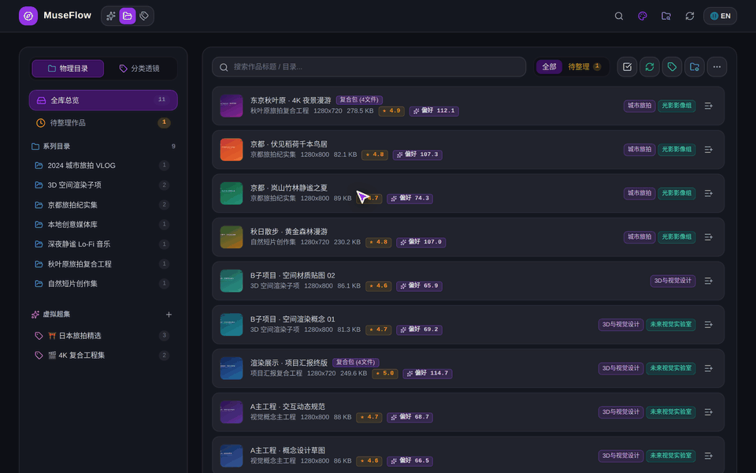

<div align="center">

# MuseFlow

Local-first, non-destructive media hub with composite bundle detection, LLM topology triage, and TikTok-style stream playback.

[](https://github.com/mcocdaa)
[](https://github.com/mcocdaa/MuseFlow/actions)
[](https://github.com/mcocdaa/MuseFlow/releases)
[](backend/pyproject.toml)
[](frontend/package.json)
[](docker-compose.yml)
[](LICENSE)

[English](README.md) · [简体中文](README_CN.md)



</div>

---

## ✨ Highlights

- **Zero-Destruction In-Place Indexing**: Indexes local directories, collections, and cross-collection virtual supersets directly on disk without renaming, moving, or locking your original media files.
- **Automatic Composite Bundle Binding**: Groups companion multitrack assets (`mp4 + srt + wav`, `mp3 + lrc`) into a single `AssetUnit [bundle]` with on-the-fly `.srt`/`.ass` to WebVTT subtitle transcoding and encoding auto-detection (`UTF-8`, `GBK`, `GB18030`).
- **LLM Directory Topology Triage**: Uses OpenAI-compatible reasoning models (`Grok-4.7`, `Claude 3.5`, `GPT-4o`) and an AST projection DSL to isolate nested sub-series, pair cross-folder companions, and preview changes via non-destructive dry-run evaluation.
- **Dual-Mode UI — Explorer Workplace & TikTok-Style Vertical Stream Feed**: Seamlessly toggle between a Xiaohongshu-style waterfall + TikTok-style vertical swipe reel + vinyl audio bar and a professional file topology workplace with native OS reveal (`explorer.exe /select`, `open -R`, `xdg-open`).
- **Pluggable Recommender Algorithms with 180s Anti-Hang Dwell Cap**: Built-in **Discover**, **Flashback**, and **Affinity** algorithms powered by rating, favorite, and playback telemetry strictly capped at `min(dwell, 180s)` to prevent idle tabs from skewing weights.
- **7 Curated Themes**: Instant, persistent `localStorage` switching across Cyber Dark, OLED Pure Black, Sakura Pink, Cyberpunk Neon, Forest Emerald, Sunset Amber, and Studio Light palettes.

<details>
<summary><b>📊 Why MuseFlow vs. Traditional Media Tools (Click to expand)</b></summary>

| Dimension | Traditional DAMs (Eagle / Billfish) | Home Theater (Jellyfin / Plex) | Cloud Photo Hubs (Immich) | **MuseFlow** |
| :--- | :--- | :--- | :--- | :--- |
| **Physical Files** | Proprietary vault import | Read-only mount | Date-tree reorganization | **Zero-destruction in-place indexing** |
| **Composite Bundles** | Fragmented orphan files | Single video focus | No multitrack pairing | **Atomic `mp4 + srt + wav` bundles** |
| **Directory Topology** | Manual tagging | Rigid folder scan | Chronological flattening | **LLM topology triage + dry-run preview** |
| **Consumption UI** | Dense grid only | TV poster wall | Timeline grid | **Waterfall + TikTok Vertical Reel + Audio Bar** |
| **Recommender** | None | Recently added only | None | **Pluggable (Discover / Flashback / Affinity)** |

</details>

---

## 🚀 Quick Start

### Option 1: Docker Compose (1 Command)

```bash
cp .env.example .env && docker compose up -d --build
```

Open **`http://localhost:8765`** (or your configured `MUSEFLOW_PORT` in `.env`).

### Option 2: Local Dev (`uv` + `npm`)

```bash
cp .env.example .env
cd backend && uv sync && uv run python generate_samples.py
cd ../frontend && npm install && npm run dev &
cd ../backend && uv run uvicorn app.main:app --reload --port 8765
```

<details>
<summary><b>⚙️ Environment Variables Reference</b></summary>

| Variable | Default | Description |
| :--- | :--- | :--- |
| `MUSEFLOW_HOST` | `127.0.0.1` | Server bind address (`0.0.0.0` in Docker for LAN access) |
| `MUSEFLOW_PORT` | `8765` | Backend & web UI port (default `8765`) |
| `MUSEFLOW_DATA_DIR` | `backend/data` | SQLite database and generated thumbnail cache directory |
| `MAX_DWELL_SECONDS` | `180.0` | Anti-hang telemetry dwell time cap per playback session |
| `LLM_BASE_URL` | `https://api.openai.com/v1` | OpenAI-compatible API endpoint |
| `LLM_API_KEY` | `your_api_key_here` | API key for LLM directory topology triage |
| `LLM_MODEL` | `gpt-4o` | Model identifier (`grok-4.7`, `gpt-4o`, `claude-3-5-sonnet`, etc.) |

</details>

---

## 🤖 AI & API Usage

MuseFlow exposes a full REST API (interactive OpenAPI docs at `/docs`) and MCP server tools for autonomous agents:

```bash
# 1. List indexed atomic media assets (/api/assets)
curl -s "http://localhost:8765/api/assets?unit_type=video&limit=10" | jq .

# 2. Fetch personalized stream recommendations (/api/recommend)
curl -s "http://localhost:8765/api/recommend/feed?mode=unit&algorithm=affinity&limit=5" | jq .

# 3. Non-destructive dry-run topology triage evaluation (/api/organize/pipeline/evaluate)
curl -s -X POST "http://localhost:8765/api/organize/pipeline/evaluate" \
  -H "Content-Type: application/json" \
  -d '{
    "collection_id": 1,
    "pipeline": {
      "levels": [
        {"level_index": 0, "facet": "tag.domain", "fallback": "General"},
        {"level_index": 1, "naming": "{unit.title}%unique{}"}
      ]
    }
  }' | jq .
```

> **Tip**: Run `cd backend && uv run python -m app.mcp.server` to launch the Model Context Protocol (MCP) server for Claude Desktop or Cursor agents.

---

## 📚 Documentation & License

- 🏛️ [System Architecture & Domain Model](docs/architecture.md)
- 🤖 [LLM Directory Topology Triage Guide](docs/ai_triage_guide.md)
- 🔌 [Pluggable Recommender & Telemetry Specification](docs/recommender_plugin.md)
- 🛠️ [AI Agent Guidelines](AGENTS.md) · [Contributing](CONTRIBUTING.md) · [Security Policy](SECURITY.md) · [Changelog](CHANGELOG.md)

Licensed under the [MIT License](LICENSE).
